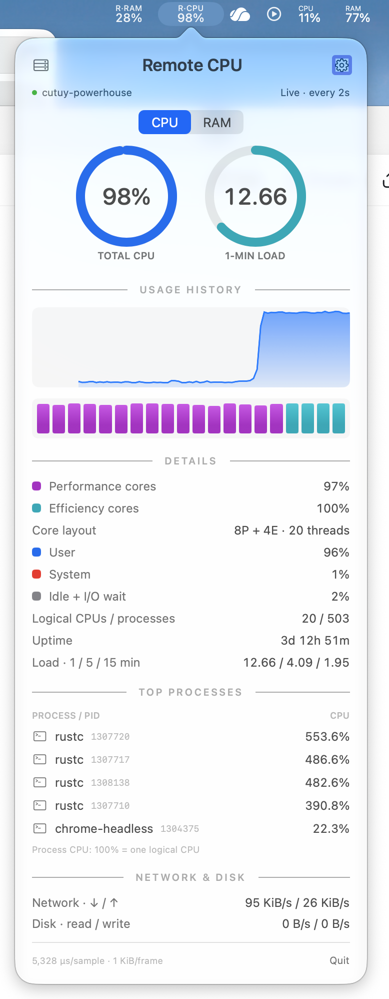

# Remote Stats

A native macOS menu bar monitor for Linux over SSH, inspired by [Stats](https://github.com/exelban/stats).



- CPU and RAM panels with history, load averages, and top-five processes.
- One row of CPU bars: purple P-core threads, teal E-cores on supported Intel hybrid CPUs.
- Network/disk throughput, swap, uptime, and filesystem capacity.
- Small C collector and Swift client. Fixed 1 KiB frames every 2 seconds; the collector sleeps without clients.
- Uses existing SSH keys and host verification. The collector listens on Linux loopback only.

## Install

Requirements: macOS 13+ with Apple command line tools, Linux with a C compiler,
Python 3 and systemd, and working key-based SSH between them. Clone this repository
on both machines in a location of your choice.

**Linux**

```sh
./scripts/install-server.sh
# To start at boot without logging in (once per user):
sudo loginctl enable-linger "$USER"
```

**Mac**

```sh
./scripts/install-macos.sh
```

Choose `user@host` or an SSH config alias in the app’s settings. The Mac app starts
at login; the Linux user service restarts on failure. Allow Remote Stats in
System Settings → Menu Bar if the labels are hidden.

Set `REMOTE_STATS_PORT` and `REMOTE_STATS_INTERVAL_MS` when installing the server
to override the defaults (47391 and 2000 ms). Match the port in the Mac settings.

## Develop

```sh
make server test                 # Linux
make macos                      # Mac, native architecture
./scripts/test-macos.sh          # Mac protocol tests
```

CPU total is normalized across all logical CPUs; process CPU uses 100% per logical
CPU. RAM used is total minus available; process RAM is RSS. Network counters cover
physical interfaces. [Wire format and metric details](protocol/PROTOCOL.md).

Service logs: `journalctl --user -u remote-stats`. Stop with
`systemctl --user disable --now remote-stats`. On Mac, quit from either panel;
the login agent is `com.cutuy.remote-stats` in `~/Library/LaunchAgents`.

[MIT license](LICENSE).
